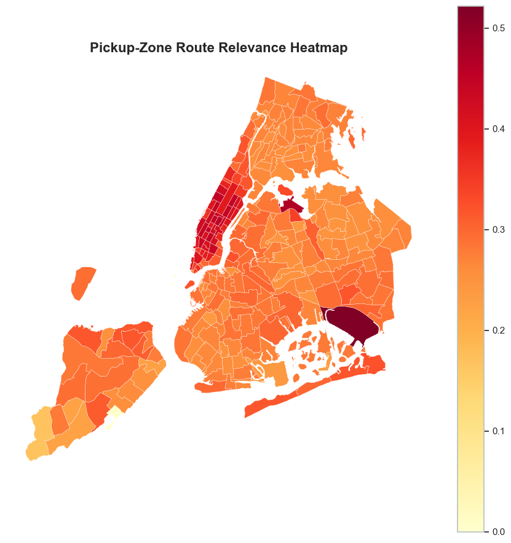
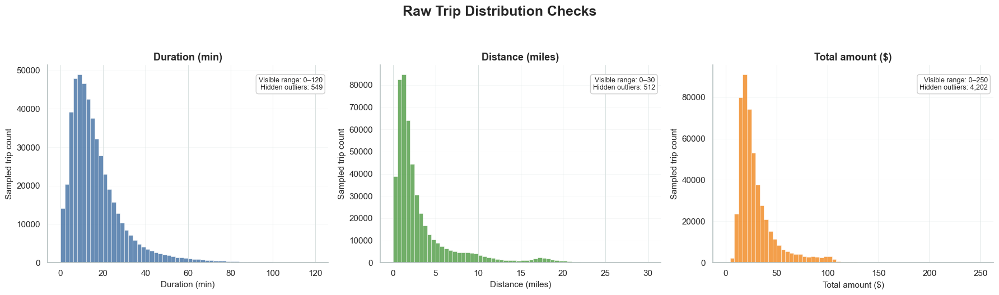
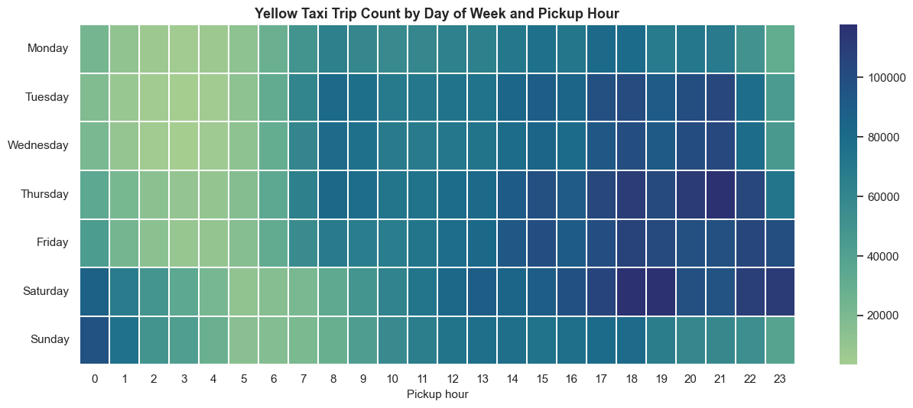
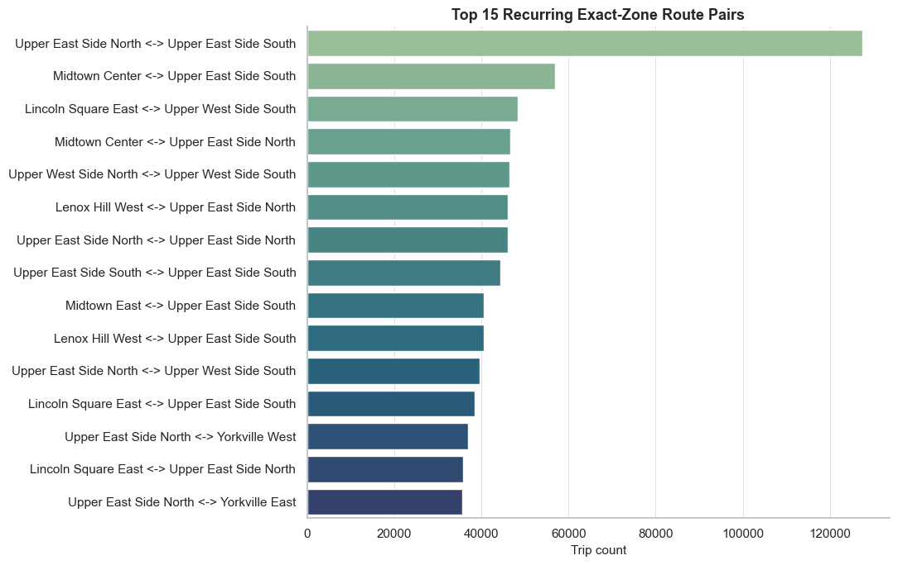
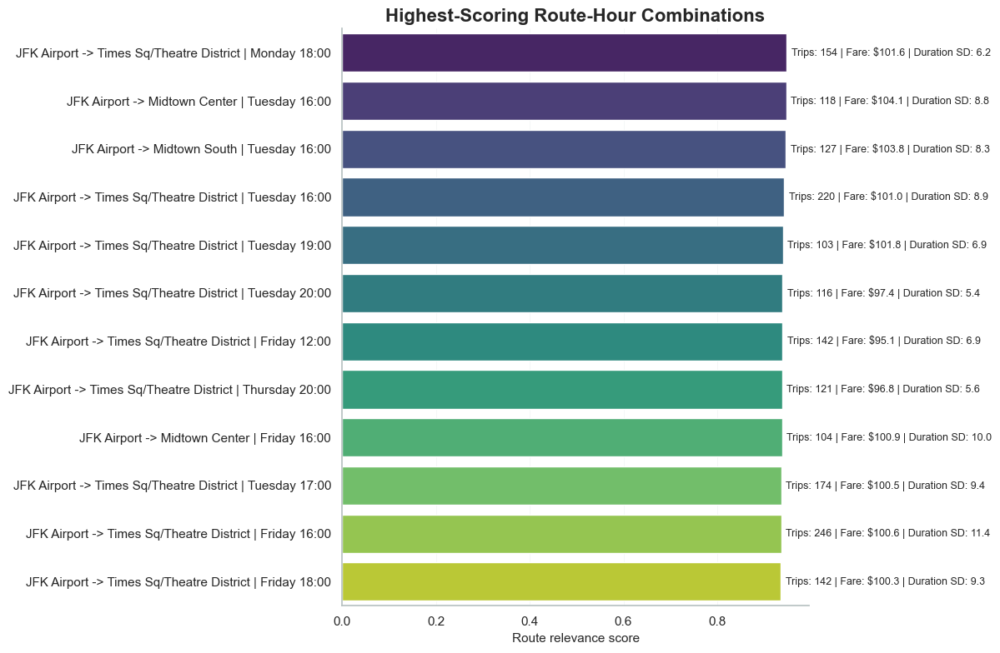
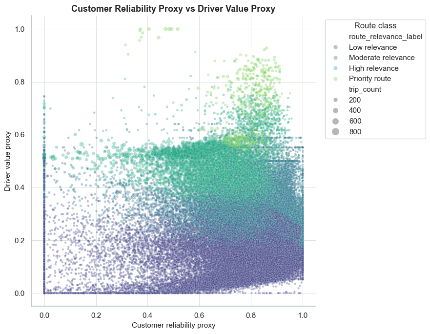
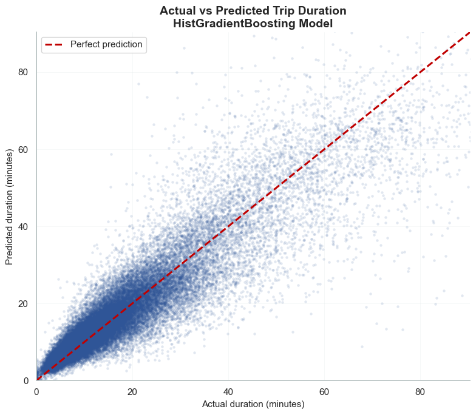
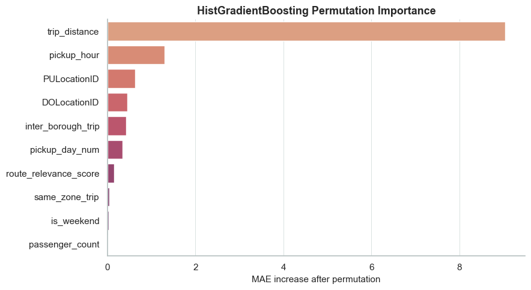

# NYC Taxi Route Intelligence

**Turning 11 million raw NYC Yellow Taxi trips into route-level insight and trip duration / fare predictions.**


This project builds an end-to-end data pipeline on the official [NYC TLC Yellow Taxi trip records](https://www.nyc.gov/site/tlc/about/tlc-trip-record-data.page) for January to March 2026. It starts with the raw monthly Parquet files and works through validation, cleaning, geographic enrichment and feature engineering. From there it builds a **route relevance score** for every pickup-zone → drop-off-zone × day × hour combination, then trains models that predict trip duration and fare.

📄 **Full write-up:** [`tlc_route_intelligence_two_column_report.pdf`](tlc_route_intelligence_two_column_report.pdf)
📓 **Notebook:** [`SIT220_8HD_TLC_Route_Intelligence_Report.ipynb`](SIT220_8HD_TLC_Route_Intelligence_Report.ipynb)

<p align="center">
  
  <br>
  <em>Average route relevance of outgoing trips by pickup zone. Manhattan and the airports stand out.</em>
</p>

---

## Highlights

| | |
|---|---|
| **Raw records processed** | 11,077,206 trips (Jan–Mar 2026) |
| **After cleaning** | 10,487,427 trips (5.32% removed as invalid) |
| **Unique zone-to-zone routes** | ~47,900 across 262 taxi zones |
| **Best duration model** | HistGradientBoosting: **MAE 3.79 min, R² 0.82** |
| **Fare model** | Ridge: **MAE $3.46, R² 0.85** on `fare_amount` |

## The problem

Raw taxi data tells you that a trip happened. It doesn't tell you which routes matter. The same corridor can be busy and predictable on a weekday evening and nearly empty at 3 a.m. on a Sunday. This project uses the **route-hour** (origin zone, destination zone, day of week, pickup hour) as its unit of analysis and asks four questions:

1. **Recurrence**: does this route-hour show up again and again?
2. **Reliability**: is its travel time consistent?
3. **Commercial value**: does it produce meaningful fares?
4. **Predictive usefulness**: do route and time features help predict duration and fare?

## Pipeline

```
Raw Parquet (3 months, 11M rows)
   │
   ├─ 1. Schema inspection & missing-value audit
   ├─ 2. Validation: out-of-scope dates, negative/zero durations & distances,
   │                 negative fares, speeds > 80 mph
   ├─ 3. Cleaning function (reproducible, explicit date scope)
   ├─ 4. Taxi-zone metadata join (zone names, boroughs, service zones)
   ├─ 5. Feature engineering: temporal, route identity, inter-borough flags,
   │                          speed, fare-per-mile, tip %
   ├─ 6. Exploratory analysis
   ├─ 7. Route-hour aggregation
   ├─ 8. Route relevance scoring + geospatial heatmap
   ├─ 9. Modelling: duration (Ridge vs HistGradientBoosting), fare & total amount
   └─ 10. Passenger/driver proxy analysis & PnL scenario simulation
```

## Exploring the data

Raw duration, distance and payment are all heavily right-skewed. Thousands of outliers (multi-day trips, $1000+ fares) are hidden beyond the plotted range, which is why the cleaning stage matters.



Demand follows a clear weekly rhythm: weekday evening peaks, Friday and Saturday nights that run late, and a quiet pre-dawn window every day.



Recurring volume sits in a small number of short Upper East Side, Upper West Side and Midtown hops.



## Route relevance score

Each route-hour gets a continuous score in [0, 1] built from robust-scaled components. Extreme values are clipped before scaling so one outlier route can't dominate:

| Component | Weight | Signal |
|---|---|---|
| Frequency | 0.45 | Trip count and how many days the route-hour was active |
| Duration reliability | 0.30 | Low coefficient of variation in trip duration |
| Fare value | 0.25 | Average passenger payment |

Scores are then banded into *Low*, *Moderate*, *High* and *Priority*. The top routes are mostly JFK/LaGuardia → Midtown corridors at weekday afternoon and evening peaks. Zone-level averages are mapped over the TLC taxi-zone shapefile to show where high-relevance pickups cluster.



Plotting a customer-reliability proxy against a driver-value proxy shows that priority routes sit in the upper-right corner, where they are both predictable and lucrative. So the score captures more than raw trip volume.

<p align="center">
  
</p>

## Modelling results

All models are evaluated on the same held-out split (6.1M train / 1.5M test rows). To avoid leakage, features are limited to what is known at or before dispatch, so actual duration, tips, tolls and surcharges are never used as inputs.

**Trip duration (minutes)**

| Model | MAE | RMSE | R² |
|---|---|---|---|
| Ridge (baseline) | 5.97 | 9.33 | 0.63 |
| **HistGradientBoosting** | **3.79** | **6.49** | **0.82** |

**Fare prediction (two-target Ridge)**

| Target | MAE | RMSE | R² |
|---|---|---|---|
| `fare_amount` | $3.46 | $7.11 | 0.85 |
| `total_amount` | $5.21 | $9.56 | 0.82 |

Permutation importance shows **trip distance** as the dominant driver of duration, followed by **pickup hour**, pickup and drop-off zone, inter-borough movement and day of week. The route relevance score adds a modest but real signal.

<table>
  <tr>
    <td width="50%"></td>
    <td width="50%"></td>
  </tr>
  <tr>
    <td align="center"><em>Predictions track the diagonal closely up to about 40 minutes</em></td>
    <td align="center"><em>Distance dominates, then time of day and location</em></td>
  </tr>
</table>

## Key findings

- **Demand is highly concentrated.** Of ~48k possible routes, a small set of Manhattan corridors and airport movements carry most of the volume. The busiest single route is Upper East Side South → Upper East Side North, with 68k trips.
- **Time matters as much as place.** The same route has very different value depending on hour and day, which is why the analysis works at route-hour level instead of using static origin-destination pairs.
- **Raw TLC data needs strict cleaning.** About 28% of records have missing or zero passenger counts. The data also contains negative fares, time-travelling timestamps (including a pickup dated 2008) and speeds in the millions of mph.
- **Non-linear models clearly win on duration.** Congestion and zone × time interactions are things a linear model can't capture.
- **Total amount is harder to predict than the metered fare**, because tips, tolls and surcharges add variance that pre-trip features don't explain.

## Project structure

```
.
├── SIT220_8HD_TLC_Route_Intelligence_Report.ipynb   # Main analysis notebook
├── SIT220_8HD_TLC_Route_Intelligence_Report.html    # Rendered notebook
├── tlc_route_intelligence_two_column_report.pdf     # Written report
├── images/                                          # Figures exported from the notebook
├── data/
│   ├── raw/                     # yellow_tripdata_2026-0{1,2,3}.parquet (not committed)
│   ├── taxi_zones/              # TLC taxi-zone shapefile
│   └── taxi_zone_lookup.csv     # LocationID → zone / borough
└── models/                      # Saved .joblib models (estimator, features, scaler, metrics)
```

## Getting started

**1. Install dependencies**

```bash
pip install pandas pyarrow numpy scikit-learn matplotlib seaborn geopandas folium joblib jupyter
```

**2. Download the data** from the [TLC Trip Record Data page](https://www.nyc.gov/site/tlc/about/tlc-trip-record-data.page):

- Yellow Taxi Trip Records for **January, February and March 2026** → `data/raw/`
- **Taxi Zone Lookup Table** (CSV) → `data/taxi_zone_lookup.csv`
- **Taxi Zone Shapefile** → `data/taxi_zones/`

**3. Run the notebook**

```bash
jupyter notebook SIT220_8HD_TLC_Route_Intelligence_Report.ipynb
```

> ⚠️ The notebook loads all 11M rows into pandas, so expect to need **16 GB+ of RAM**. For less memory, load fewer months or sample the data.

## Limitations & future work

- The records cover completed trips only. Dispatch events, wait times, idle time and cancellations aren't observed.
- "Satisfaction" and profitability are **proxies**, not measured outcomes. The PnL simulation is a scenario tool, not a finance model.
- Exact zone pairs create a long tail of sparse routes. Grouping zones into operational corridors would stabilise scores.
- Location IDs are treated as numeric. Target encoding or native categorical handling could improve the models.
- Next steps: add Green Taxi and FHV data, plus weather, holidays and events, and extend to a full year to capture seasonality.

## Author

**Sunain Mushtaq** · [GitHub @SunainM](https://github.com/SunainM)

Data © NYC Taxi & Limousine Commission, used under the [NYC Open Data terms of use](https://opendata.cityofnewyork.us/overview/#termsofuse).
